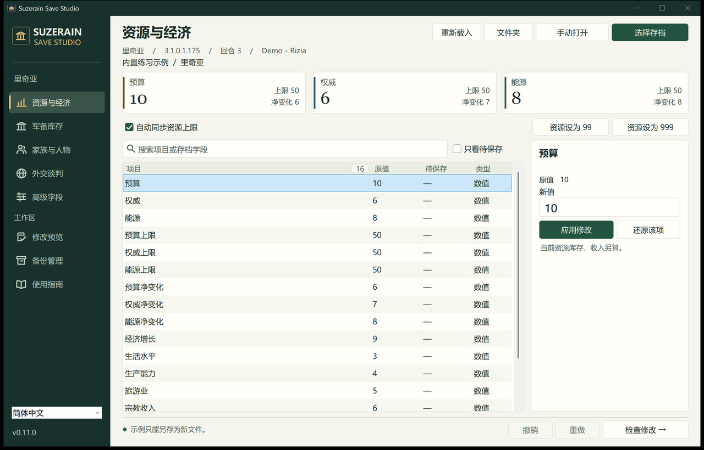

# Suzerain Save Studio

Windows 10 / 11 x64 便携存档修改器，支持《Suzerain》索德兰本体与《Kingdom of Rizia》DLC。双击单文件程序，启动后可打开自己的存档，也可先用内置战役示例练习。

**[下载 v0.11.0 Windows 版](https://github.com/lingjieheti/suzerain-save-studio/releases/download/v0.11.0/SuzerainSaveStudio-0.11.0-win-x64.exe)** · [发布说明与 SHA-256](https://github.com/lingjieheti/suzerain-save-studio/releases/tag/v0.11.0)



## 快速上手

1. 在游戏中保存并退出。启动修改器，选择自动发现的存档，或点“手动打开”。首次使用可以先选“索德兰示例”或“里奇亚示例”。
2. 选择左侧分类，按中文名称或原始字段名查找项目。比如在索德兰经济页搜索“政府 预算”，选中后输入新值并点“应用修改”。
3. 打开“修改预览”，核对原值与新值。可以单独撤回某项，也可以撤销或重做。选择“另存为”输出副本，或保存到原档，再回游戏读档。

## 功能

| 使用场景 | 可以做什么 |
| --- | --- |
| 索德兰本体 | 51 项常用字段，涵盖经济、政治、人物、外交与军事。预算与私人资产均有 +5 快捷操作。 |
| 里奇亚 DLC | 63 项常用字段，涵盖资源、军备、家族与外交。可将库存设为 99 或 999，预览中可核对联动上限。 |
| 找字段 | 常用页与高级页支持多词检索、结果计数和待保存筛选。可用中文释义或原始键搜索。中文词库覆盖已检查的 4,097 个高级字段。 |
| 修改与复用 | 在预览中逐项撤回。可导出字段 CSV，也可导入或导出绑定当前战役的修改方案。 |
| 保存与恢复 | 覆盖前生成并校验备份。恢复前也会备份当前版本。遇到外部修改或战役不匹配时会提示。内置示例只允许另存到新文件。 |
| 界面与语言 | 窄窗口切换为图标导航，支持高 DPI 和 11 种界面语言。部分较长说明及少见报错使用英文。 |

`Ctrl+L` 选择存档，`Ctrl+O` 手动打开，`Ctrl+F` 搜索，`Ctrl+S` 查看修改预览。编辑历史支持撤销与重做。备份保存在原档同目录的 `.rizia-backups` 文件夹。

## 兼容性与验证

已对 15 个索德兰和 6 个里奇亚存档进行只读验证，并在 Windows 桌面使用合成数据测试实际保存与恢复。已检查的真实存档版本为 `3.1.0.1.175` 和 `3.1.0.1.137`。目前尚未在游戏内载入改后存档，故按预览版发布。字段修改可能影响后续剧情判定。内置示例用于练习编辑流程，无法作为完整游戏存档使用。[验证记录](VALIDATION.md) · [字段依据](docs/FIELD-EVIDENCE.md) · [语言覆盖](docs/LANGUAGES.md)

## English quick start

Download the Windows x64 executable from the release link above. Open a discovered save or try either built-in sample. Select a field, enter a value and apply it. In **Review changes**, inspect each original and proposed value before saving. Saving over an existing game file creates a verified backup that you can restore from the editor. Switch interface language using the language menu. This unsigned preview has been tested with local saves and synthetic round trips. In-game loading of edited saves is still unverified.

## 从源码构建

在 Windows 上使用 x64 MinGW-w64 GCC、windres 和 PowerShell。发布程序使用 GCC 13.2.0 构建。以下命令采用 Strawberry Perl 附带工具链的默认位置。

```powershell
.\build.ps1 -Toolchain C:\Strawberry\c\bin -CompilerKind GCC
.\test.ps1 -Compiler C:\Strawberry\c\bin\g++.exe
```

程序位于 `build/SuzerainSaveStudio.exe`。测试默认使用合成数据。向 `test.ps1` 传入 `-SaveDirectory <目录>` 可额外运行只读存档检查。

本项目是独立的非官方玩家工具，与 Torpor Games 无隶属关系。应用源码使用 [MIT 许可](LICENSE)，编译运行库的许可见 [第三方说明](src/THIRD-PARTY-NOTICES.txt)。
