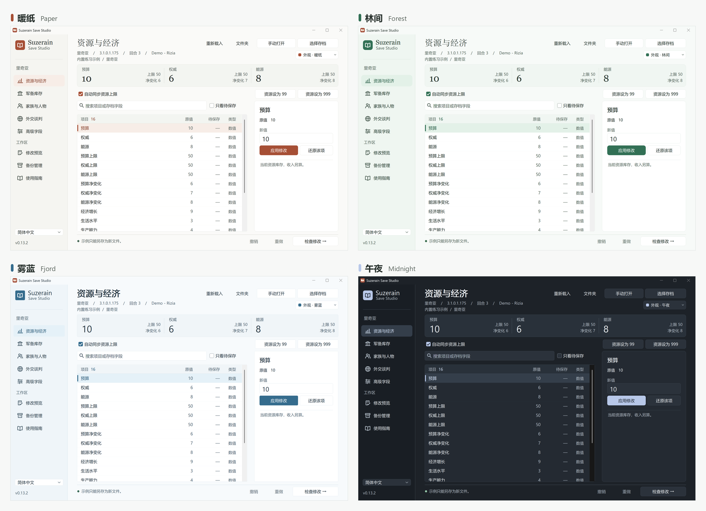

# Suzerain Save Studio

<a name="languages"></a>

**简体中文** · [繁體中文](docs/intro/zh-TW.md) · [English](docs/intro/en.md) · [日本語](docs/intro/ja.md) · [한국어](docs/intro/ko.md) · [Deutsch](docs/intro/de.md) · [Français](docs/intro/fr.md) · [Español](docs/intro/es.md) · [Português (Brasil)](docs/intro/pt-BR.md) · [Русский](docs/intro/ru.md) · [Türkçe](docs/intro/tr.md)

这是我自己玩《Suzerain》时做的小工具，平时用它查预算、改存档，也在游戏里微调资源。放在这里分享给同样喜欢索德兰和里奇亚的玩家。

支持 Windows 10 / 11 x64。解压后双击即可编辑存档，也可以先打开内置示例试试。

**[下载 v0.14.0 Windows 完整包](https://github.com/lingjieheti/suzerain-save-studio/releases/download/v0.14.0/SuzerainSaveStudio-0.14.0-Live-Preview-win-x64.zip)** · [发布说明与 SHA-256](https://github.com/lingjieheti/suzerain-save-studio/releases/tag/v0.14.0) · [♡ 赞助作者](SPONSOR.md)



[桌面编辑器大图](docs/images/rizia-workspace.png) · [存档选择器](docs/images/save-picker.png) · [修改前后对照](docs/images/change-review.png) · [实时面板离线预览](docs/images/live-panel-preview.png)

## 快速上手

完整包内含桌面编辑器和可选的 **Ctrl+F8 游戏内实时面板**。解压后运行 EXE 即可编辑存档。若要使用实时面板，在启动窗口选择“实时模式”。安装要求、可编辑的五项资源与验证范围见[实时面板使用说明](live/README.zh-CN.md)。

1. 在游戏中保存并退出。启动修改器，选择自动发现的存档，或点“手动打开”。首次使用可以先选“索德兰示例”或“里奇亚示例”。
2. 选择左侧分类，按中文名称或原始字段名查找项目。比如在索德兰经济页搜索“政府 预算”，选中后输入新值并点“应用修改”。
3. 打开“修改预览”，核对原值与新值。可以单独撤回某项，也可以撤销或重做。选择“另存为”输出副本，或保存到原档。回到游戏主菜单，手动读取刚修改的存档。

## 常用数值和收藏

- **收藏字段**。选中常用或高级字段，在右侧点“收藏字段”。换同一战役的存档后，到“高级字段”点“只看收藏”，可继续编辑这些数值。索德兰和里奇亚各用一份收藏。
- **查里奇亚资源**。在资源页核对库存与上限，按“每回合能源”等词查找回合数据。净变化是存档记下的汇总值，游戏结算时可能重新计算。
- **在游戏里微调**。按 **Ctrl+F8**，选中资源后可点 **−5、−1、+1、+5**，看清目标值再预览和确认。如果操作期间游戏已更新该资源，请按面板提示重新核对。

[查看收藏界面](docs/images/field-favorites.png) · [玩家反馈与五款同类工具对照](docs/PLAYER-RESEARCH.zh-CN.md)

## 选择外观

在存档选择器或编辑器点 **外观**，即可切换主题。默认的 **暖纸** 用暖白底和陶土色按钮。喜欢冷色可以选薄荷绿的 **林间** 或冰蓝的 **雾蓝**，夜间可选石墨灰的 **午夜**。切换主题会保留正在编辑的数值。桌面编辑器与游戏内实时面板共用这项偏好，下次打开会自动沿用。

## 功能

| 使用场景 | 可以做什么 |
| --- | --- |
| 索德兰本体 | 51 项常用字段，涵盖经济、政治、人物、外交与军事。预算与私人资产均有 +5 快捷操作。 |
| 里奇亚 DLC | 63 项常用字段，涵盖资源、军备、家族与外交。可将库存设为 99 或 999，预览中可核对联动上限。 |
| 找字段 | 常用页与高级页支持多词检索、结果计数和待保存筛选。可用中文释义或原始键搜索。中文词库覆盖已检查的 4,097 个高级字段。 |
| 修改与复用 | 在预览中逐项撤回。可导出字段 CSV，也可导入或导出绑定当前战役的修改方案。 |
| 保存与恢复 | 覆盖前生成并校验备份。恢复前也会备份当前版本。遇到外部修改或战役不匹配时会提示。内置示例只允许另存到新文件。 |
| 界面与语言 | 窄窗口切换为图标导航，支持高 DPI 和 11 种界面语言。部分较长说明及少见报错使用英文。 |

`Ctrl+L` 选择存档，`Ctrl+O` 手动打开，`Ctrl+F` 搜索，`Ctrl+S` 查看修改预览。编辑历史支持撤销与重做。备份保存在原档同目录的 `.rizia-backups` 文件夹。

## 兼容性与验证

已对 15 个索德兰和 6 个里奇亚存档进行只读验证，并在 Windows 桌面使用合成数据测试保存与恢复。已检查的真实存档版本为 `3.1.0.1.175` 和 `3.1.0.1.137`。桌面编辑器改动数值后重新进游戏读档的效果仍待验证。内置示例用于练习编辑流程。[字段依据](docs/FIELD-EVIDENCE.md) · [语言覆盖](docs/LANGUAGES.md)

在真实索德兰战役副本中，0.13.1 完成了政府预算 **16 → 17 → 16** 和个人财富 **1 → 2 → 1** 两组测试。四次操作后，游戏原生顶栏和 Ctrl+F8 面板显示的数值均一致。里奇亚的预算、权威和能源已通过模拟验证，仍待真实战役实测。[验证记录](VALIDATION.md)

## English quick start

Bookmark any available field in its inspector and find it again under **Advanced** with the favorites filter. Sordland and Rizia keep separate lists. In the live panel, use **−5, −1, +1, +5** to prepare a change, then preview and confirm it.

Choose **Appearance** in the save picker or editor to switch between **Paper**, **Forest**, **Fjord** and **Midnight**. The desktop editor and optional in-game panel remember the same choice on this PC.

Download and extract the Windows x64 ZIP above. Run the executable, open a discovered save or try either built-in sample. Select a field, enter a value and apply it. In **Review changes**, inspect each original and proposed value before saving. To use the optional in-game resource panel, choose **Live mode** on startup. It requires an existing BepInEx 6 IL2CPP installation. After installation, open a campaign and press **Ctrl+F8**. In a live Sordland campaign, v0.13.1 changed the government budget from 16 to 17 and personal wealth from 1 to 2, and restored both original values. The game's top bar and the panel agreed after all four writes. Rizia’s three resources have been tested in simulation only. [HUD verification and test coverage](VALIDATION.md)

## 从源码构建

在 Windows 上使用 x64 MinGW-w64 GCC、windres 和 PowerShell。发布程序使用 GCC 13.2.0 构建。以下命令采用 Strawberry Perl 附带工具链的默认位置。

```powershell
.\build.ps1 -Toolchain C:\Strawberry\c\bin -CompilerKind GCC
.\test.ps1 -Compiler C:\Strawberry\c\bin\g++.exe
```

程序位于 `build/SuzerainSaveStudio.exe`。测试默认使用合成数据。向 `test.ps1` 传入 `-SaveDirectory <目录>` 可额外运行只读存档检查。

本项目是独立的非官方玩家工具，与 Torpor Games 无隶属关系。应用源码使用 [MIT 许可](LICENSE)，编译运行库的许可见 [第三方说明](src/THIRD-PARTY-NOTICES.txt)。
