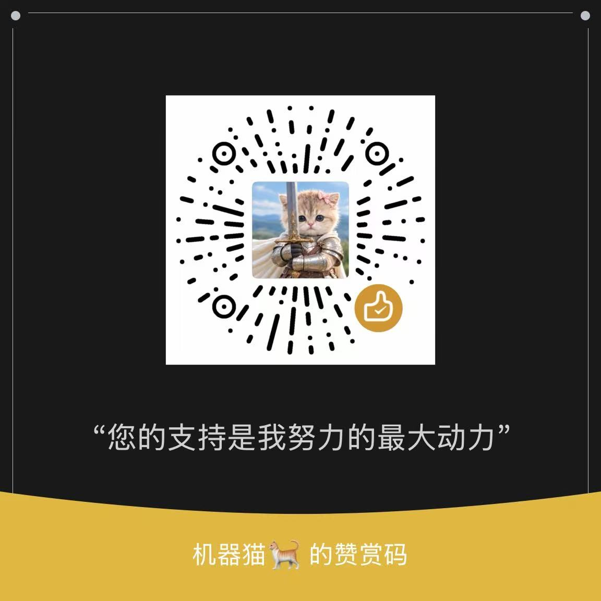

# 赞助作者

这是我自己玩《Suzerain》时做的工具。如果它帮你少翻了几次存档，也欢迎请我喝杯咖啡。金额随意，谢谢支持！

在选档窗口底部或编辑器左侧点 **赞助作者**，可以离线查看微信赞赏码、PayPal 和 USDT 收款码。

- [微信 · 展开赞赏码](#微信赞赏码)
- [PayPal · 打开收款页](https://www.paypal.com/qrcodes/p2pqrc/8CZSV4VY73PB2)
- [USDT · 查看 TRON（TRC20）收款地址](#usdttrc20)

**简体中文** · [繁體中文](docs/intro/zh-TW.md#support) · [English](docs/intro/en.md#support) · [日本語](docs/intro/ja.md#support) · [한국어](docs/intro/ko.md#support) · [Deutsch](docs/intro/de.md#support) · [Français](docs/intro/fr.md#support) · [Español](docs/intro/es.md#support) · [Português (Brasil)](docs/intro/pt-BR.md#support) · [Русский](docs/intro/ru.md#support) · [Türkçe](docs/intro/tr.md#support)

## 微信赞赏码

展开下图，用微信「扫一扫」即可赞赏。在手机上浏览时，可以点开原图保存，再从微信「扫一扫」的相册中选取。

<details>
<summary>查看微信赞赏码 · WeChat appreciation code</summary>

<a href="docs/sponsor/wechat-appreciation.jpg?raw=true"></a>

</details>

## PayPal

可以[打开我的 PayPal 收款页](https://www.paypal.com/qrcodes/p2pqrc/8CZSV4VY73PB2)，也可以用 PayPal 扫码。

<details>
<summary>PayPal 收款码</summary>

<a href="docs/sponsor/paypal.jpg?raw=true"></a>

</details>

## USDT（TRC20）

币种请选择 **USDT**，网络请选择 **TRON（TRC20）**。下方是我的收款地址，可直接复制。

```text
TXE2VuxUSFsenJvmz3Z8oSm7dqPLAUWfRE
```

<details>
<summary>查看原始充值二维码与网络说明</summary>

<a href="docs/sponsor/usdt-trc20.jpg?raw=true"></a>

</details>

[返回 Suzerain Save Studio](README.md)
