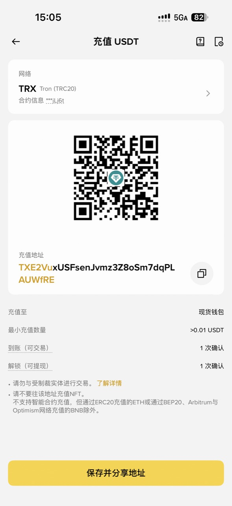

# 赞助作者

这是我自己玩《Suzerain》时做的工具。如果它帮你少翻了几次存档，也欢迎请我喝杯咖啡。金额随意，谢谢支持！

**[PayPal 付款](https://www.paypal.com/qrcodes/p2pqrc/8CZSV4VY73PB2)** · **[USDT（TRC20）](#usdttrc20)**

## PayPal

可以[打开我的 PayPal 收款页](https://www.paypal.com/qrcodes/p2pqrc/8CZSV4VY73PB2)，也可以用 PayPal 扫码。

<details>
<summary>PayPal 收款码</summary>

<a href="docs/sponsor/paypal.jpg"></a>

</details>

## USDT（TRC20）

币种请选择 **USDT**，网络请选择 **TRON（TRC20）**。下方是我的收款地址，可直接复制。

```text
TXE2VuxUSFsenJvmz3Z8oSm7dqPLAUWfRE
```

<details>
<summary>查看原始充值二维码与网络说明</summary>

<a href="docs/sponsor/usdt-trc20.jpg"></a>

</details>

[返回 Suzerain Save Studio](README.md)
