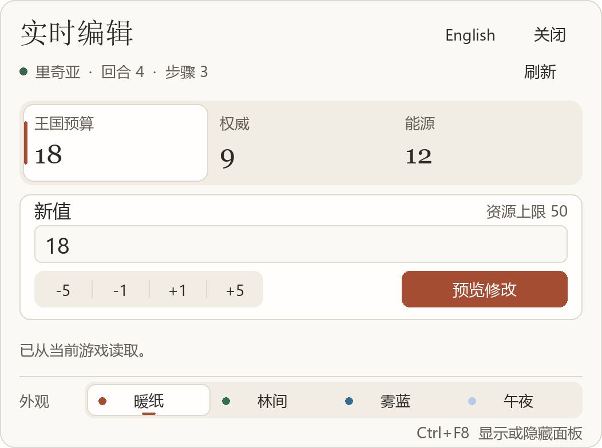

# Suzerain Save Studio 游戏内实时面板

适用于 Windows x64 Steam 版《Suzerain》和 BepInEx 6 IL2CPP。此技术预览使用游戏内的 Dialogue System 变量接口。安装后可直接在当前回合读写数值。离线存档修改器仍可单独使用。

| 战役 | 可修改的数值 |
| --- | --- |
| 索德兰 | 政府预算、私人资产 |
| 里奇亚 | 预算、权威、能源 |



上图截自游戏主菜单。载入战役后，面板会列出当前可调的资源。面板内可用 Tab 和 Shift+Tab 移动焦点、Enter 操作选中的按钮、Esc 取消。

0.16.1 使用游戏自带的界面字体显示中文和英文。标题与主按钮加粗，库存和确认前后的数值使用较大的常规字。窄屏下，较长的英文资源名和数值会按可用宽度缩小。

首次打开默认使用清爽的 **雾蓝**。点面板的外观选项即可切换 **暖纸、林间、雾蓝、午夜**。桌面编辑器与游戏内面板共用主题偏好，重新打开面板时会读取最近的选择。正在输入或等待确认的数值会保留。

## 悬停显示选项结果

1. 按 **Ctrl+F8**，找到「悬停显示选项结果」，点「已关闭」切换为「已开启」。也可以从桌面修改器的「实时模式」勾选。开关会记住上次的选择，首次使用默认关闭。
2. 关掉实时面板，再把鼠标移到对话答复、决议或序章轮播的当前选项上。小窗跟随鼠标，移开后消失。序章轮播显示当前选项在最终确认时的效果，法案的签署与否决分别预览，法令显示颁布时的效果。
3. 提示区分增减与设定值，只显示脚本可确认的变化。阅读式序章里，若选项与结果之间只隔着固定的插图和旁白，也会显示这项结果。有些选项只记剧情标记，另一些要到后续事件才结算；遇到这些情况会提示信息有限。悬停不会选择选项或写入剧情变量。可在面板右上角切换中英文，重启游戏后会记住语言。

## 安装和使用

1. 退出游戏，解压实时版 ZIP，使 EXE 和 DLL 位于同一目录。
2. 打开 `SuzerainSaveStudio.exe`，在启动窗口点 **实时模式**。选择游戏目录里的 `Suzerain.exe`，程序会把插件复制到已有的 BepInEx。若提示已有其他版本，请先将旧版 `SuzerainSaveStudio.Live.dll` 移出 `BepInEx/plugins`，再重新安装。
3. 启动游戏并读取战役，按 **Ctrl+F8** 显示面板。选择字段，直接输入整数，或用 **−5、−1、+1、+5** 连续调整草稿。点 **预览修改**，核对前后数值，再点 **确认写入游戏**。面板会回读结果。若游戏在此期间改变了该资源或上限，请按最新数值重新调整。
4. 里奇亚库存遵循当前战役的资源上限。游戏内编辑作用于运行中的回合。需要保留这些修改时，通过游戏正常保存进度。

也可以将 `SuzerainSaveStudio.Live.dll` 手动放入游戏的 `BepInEx/plugins/SuzerainSaveStudio/`。游戏需已用 BepInEx 6 IL2CPP 成功运行过一次。已有基于该宿主的翻译插件时，可直接使用同一个宿主。卸载时先退出游戏，然后只移除上述目录中的 `SuzerainSaveStudio.Live.dll`。

## 验证范围

0.13.1 已在 Windows Steam 版索德兰战役副本中实测。政府预算从 16 改为 17，再恢复到 16。个人财富从 1 改为 2，再恢复到 1。四次操作后，游戏原生顶栏和实时面板均显示对应的新值。里奇亚的预算、权威和能源已通过模拟验证，仍待真实战役实测。

0.15.1 通过了 73 项模拟战役状态检查和 218 项面板检查，覆盖清爽雾蓝的默认设置、四种已保存的主题选择以及文字与背景对比度。已检查中英文、四种主题和三种屏幕尺寸，包括 320×240。新版加减按钮已在模拟战役验证。若面板显示「等待读取战役存档」，请先从主菜单读取可玩战役。

## 从源码构建

使用 .NET 6 SDK，或已装 .NET 6 目标包的兼容 SDK。在仓库根目录运行以下命令，将路径替换为自己的游戏安装目录。

```powershell
.\live\build-live.ps1 -GameRoot 'D:\SteamLibrary\steamapps\common\Suzerain'
```

插件位于 `build/live/SuzerainSaveStudio.Live.dll`。构建只引用本机的游戏和宿主，不会将游戏程序集打入插件。
